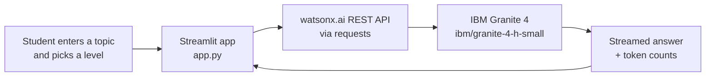

<div align="center">

# 📚 SimpleStudy

### Course Content Simplification Agent

**Hard course topics, explained simply — in under 120 words, every time.**

Powered by **IBM watsonx.ai** · **IBM Granite 4** · Built with **IBM Bob**, Python and Streamlit

[](https://www.python.org/)
[](https://streamlit.io/)
[](https://www.ibm.com/watsonx)
[](tests/test_app.py)
[](LICENSE)

</div>

---

## 🎯 What is SimpleStudy?

SimpleStudy is an AI-powered web app that takes any **Cloud Computing course topic** and simplifies it for students in India. Paste a topic, pick your level, and get a clean, structured answer in seconds — no jargon, no confusion.

### Every answer follows the same format

| Section | What you get |
|---|---|
| 📝 **Summary** | 2 short lines covering the core idea |
| 🔑 **Key terms** | Each term explained with a real-life example |
| 🧠 **Remember** | Exactly 3 bullet points to remember |
| ❓ **Quick check** | 1 question to test your understanding |

---

## ✨ Features

| | Feature | Description |
|---|---|---|
| 🎓 | **3 learning levels** | Beginner, Intermediate or Expert, chosen with a radio button |
| 💬 | **Chat history** | All your questions and answers stay visible in one session |
| ⚡ | **Word-by-word streaming** | The answer appears live as it is generated |
| 📊 | **Live token counts** | Input, output and total tokens after every answer |
| 🔢 | **Session token tracker** | Cumulative totals shown in the sidebar |
| 🗑️ | **Clear Chat button** | Start fresh at any time |
| 🔒 | **Responsible AI** | Never adds uncertain facts and politely refuses unclear input |

---

## 🖥️ Demo

| Level | Sample prompt | What you get |
|---|---|---|
| 🟢 Beginner | *What is cloud computing?* | Simple summary with everyday examples |
| 🟡 Intermediate | *Explain IaaS, PaaS and SaaS* | Clear definitions with brief technical context |
| 🔴 Expert | *Role of a hypervisor in virtualization* | Concise, precise technical explanation |

<!--
Add screenshots here after you upload them to the repo, for example:

-->

---

## 🏗️ How It Works



### Model configuration

| Parameter | Value |
|---|---|
| Model ID | `ibm/granite-4-h-small` |
| Temperature | `0.1` |
| Max tokens | `1000` |
| Response format | Summary · Key terms · Remember · Quick check |
| Max response length | 120 words |

---

## 🛠️ Tech Stack

| Tool | Purpose |
|---|---|
| [IBM Bob](https://www.ibm.com/products/bob) | AI coding assistant that built and migrated this project in VS Code |
| [IBM watsonx.ai](https://www.ibm.com/watsonx) | Hosts the Granite model and tracks token usage |
| `ibm/granite-4-h-small` | IBM Granite 4 model: fast, low-cost, well suited to short explanations |
| [Python 3.10+](https://www.python.org/) | Core language |
| [Streamlit](https://streamlit.io/) | Web UI framework |
| `requests` | Calls the watsonx.ai REST API |
| `python-dotenv` | Loads credentials from `.env` |
| `pytest` | Unit tests |

---

## 🚀 Getting Started

### Prerequisites

- Python 3.10 or later — [download](https://www.python.org/downloads/)
- An IBM Cloud account — [sign up free](https://cloud.ibm.com/registration)
- A watsonx.ai project — [get started](https://www.ibm.com/watsonx)

### 1. Clone the repository

```bash
git clone https://github.com/Lavrajpardhi/My-course-simplifier.git
cd My-course-simplifier
```

### 2. Create and activate a virtual environment

**Windows**

```cmd
python -m venv .venv
.venv\Scripts\activate
```

**macOS / Linux**

```bash
python3 -m venv .venv
source .venv/bin/activate
```

### 3. Install the dependencies

```bash
pip install -r requirements.txt
```

### 4. Set up your credentials

Copy the template:

```bash
copy .env.example .env        # Windows
cp .env.example .env          # macOS / Linux
```

Open `.env` and replace the placeholders:

```env
WATSONX_API_KEY=your-ibm-cloud-api-key-here
WATSONX_PROJECT_ID=your-watsonx-project-id-here
WATSONX_URL=https://us-south.ml.cloud.ibm.com
```

| Variable | Where to get it |
|---|---|
| `WATSONX_API_KEY` | [cloud.ibm.com](https://cloud.ibm.com) → Profile (top right) → **IBM Cloud API keys** → Create |
| `WATSONX_PROJECT_ID` | [dataplatform.cloud.ibm.com](https://dataplatform.cloud.ibm.com) → your project → **Manage** tab → Project ID |
| `WATSONX_URL` | `https://us-south.ml.cloud.ibm.com` (Dallas, default) |

> ⚠️ **Never upload your `.env` file to GitHub.** It holds your secret key and is already listed in `.gitignore`.

### 5. Run the app

```bash
streamlit run app.py
```

The app opens at **http://localhost:8501** 🎉

---

## 🧪 Running the Tests

```bash
pytest tests/ -v
```

Expected output:

```
tests/test_app.py::TestMissingCredentials::test_missing_api_key_returns_error   PASSED
tests/test_app.py::TestMissingCredentials::test_all_credentials_present_returns_none  PASSED
tests/test_app.py::TestSystemMessage::test_system_message_contains_simplestudy  PASSED
tests/test_app.py::TestSystemMessage::test_system_message_contains_level_instruction PASSED
tests/test_app.py::TestLevelPrependedToPrompt::test_level_prepended             PASSED

5 passed
```

All 5 tests run with **no real API calls**.

---

## 📁 Project Structure

```
My-course-simplifier/
├── app.py                  # Streamlit application (main file)
├── requirements.txt        # Python dependencies
├── .env.example            # Credential template (safe to share)
├── .gitignore              # Keeps .env, .venv and __pycache__ out of Git
├── README.md               # This file
└── tests/
    ├── conftest.py         # Adds the project root to sys.path
    └── test_app.py         # 5 pytest unit tests
```

---

## 🔒 Responsible AI

SimpleStudy is designed with safety from the start:

- ✅ **No made-up facts:** the model is told never to add facts it is unsure about
- ✅ **Polite refusal:** unclear or off-topic input gets a gentle redirect
- ✅ **Short answers only:** replies are capped at 120 words
- ✅ **No credentials in code:** all secrets live in `.env`, never in the source

---

## 🔮 Future Scope

- [ ] **PDF / notes upload:** simplify faculty notes using RAG
- [ ] **Hindi and Marathi support:** regional language explanations
- [ ] **Quiz and progress tracking:** check *Quick check* answers and track learning
- [ ] **More subjects:** extend beyond Cloud Computing to any course

---

## 👤 Author

**Lavraj Ashok Pardhi**
BCA Graduate, 2026 · Tilak Maharashtra Vidyapeeth, Pune

[](https://github.com/Lavrajpardhi)

---

## 📄 License

This project is licensed under the **MIT License**. See the [LICENSE](LICENSE) file for details.

---

<div align="center">

Built with ❤️ using **IBM Bob** · **IBM watsonx.ai** · **Python** · **Streamlit**

</div>
