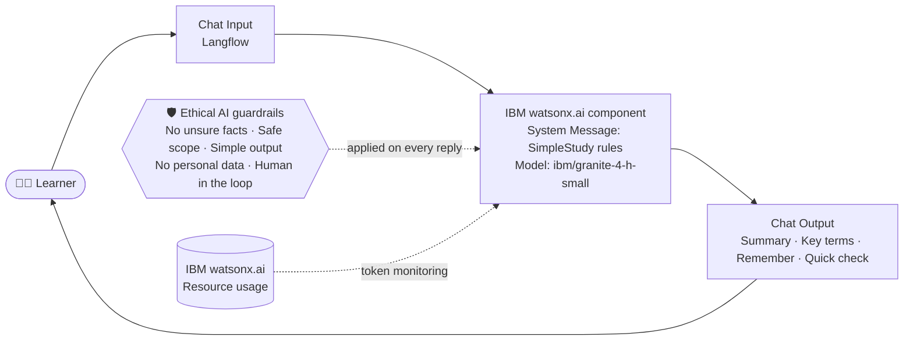

<div align="center">

# 📚 SimpleStudy – Course Content Simplification Agent

### An AI agent that turns jargon-heavy course content into simple, easy-to-learn explanations


**Edunet Foundation + IBM SkillsBuild | AICTE Internship 2026 | Agentic AI**
**Problem Statement No. 19 – Course Content Simplification Agent**

</div>

---

## 📑 Table of Contents

- [Overview](#-overview)
- [Problem Statement](#-problem-statement)
- [Target Users and Pain Points](#-target-users-and-pain-points)
- [Features](#-features)
- [Architecture](#-architecture)
- [Ethical and Responsible AI](#-ethical-and-responsible-ai)
- [Tech Stack](#-tech-stack)
- [How to Run in Langflow](#-how-to-run-in-langflow)
- [Import app.json](#-import-appjson)
- [Demo](#-demo)
- [Token Usage](#-token-usage)
- [Project Structure](#-project-structure)
- [Current Scope and Future Scope](#-current-scope-and-future-scope)
- [Author](#-author)
- [License](#-license)

---

## 🌟 Overview

**SimpleStudy** is a simple AI agent for students. The student pastes a course topic or a hard paragraph, and the agent explains it in **very simple English** with everyday examples.

It is built in **Langflow** and uses the **IBM Granite** model (`ibm/granite-4-h-small`) on **IBM watsonx.ai**, running on **IBM Cloud Lite**.

Every answer follows the same short format (under 120 words):

| Part | What it gives the learner |
|---|---|
| **Summary** | The topic in 2 short lines |
| **Key terms** | Each hard term in one simple line, with a small everyday example |
| **Remember** | Exactly 3 short bullet points |
| **Quick check** | Exactly 1 question to test understanding |

---

## 🎯 Problem Statement

> Educational materials often vary in complexity and are not always accessible to learners with different levels of prior knowledge. Students may struggle to grasp key concepts due to jargon-heavy or overly advanced explanations in faculty notes and textbooks. The challenge is to develop an AI-powered agent that can intelligently analyze academic content and reframe explanations for the learner, supporting more inclusive and personalized education delivery at scale.

The full problem statement is in [`docs/My-Problem-Statement.pdf`](docs/My-Problem-Statement.pdf).

---

## 👩‍🎓 Target Users and Pain Points

**Target user:** beginner students (for example BCA or first-year students) who study Cloud Computing from faculty notes and textbooks.

| Pain point | How SimpleStudy helps |
|---|---|
| Hard technical words (jargon) make notes difficult to follow | Rewrites them in very simple English |
| One fixed explanation does not suit every learner | Uses everyday examples (photo album, library shelves, cashiers) |
| No quick way to check understanding while studying alone | Ends every answer with a Quick check question |

---

## ✨ Features

- 🧠 **Simple explanations**: very simple words and short sentences
- 🧩 **Fixed learner-friendly format**: Summary, Key terms, Remember, Quick check
- 🏠 **Real-life examples**: every key term comes with an everyday example
- 🛡️ **Responsible by design**: no unsure facts, and a polite request for a clear topic if the input is unclear
- ⚡ **Fast and light**: only 3 Langflow components, about 7 seconds per reply
- ♻️ **Easy to reuse**: change the System Message to adapt it to any subject

---

## 🏗️ Architecture



**Flow:** `Chat Input → IBM watsonx.ai (Granite) → Chat Output`

---

## 🛡️ Ethical and Responsible AI

| Principle | How it is built into SimpleStudy |
|---|---|
| **Honest answers** | The System Message says: do not add facts you are not sure about |
| **Safe scope** | If the input is unclear or not a course topic, the agent only asks for a clear course topic |
| **Clear and simple** | Fixed 4-part format, very simple English, under 120 words |
| **Privacy and security** | The flow does not ask for personal data. The API key is **removed** from `app.json` and is never stored in this repository |
| **Human in the loop** | The Quick check question helps the learner confirm understanding, and the learner should verify with faculty notes |

---

## 🧰 Tech Stack

| Technology | Purpose |
|---|---|
| **Langflow** | Visual design and testing of the AI workflow |
| **IBM Granite** (`ibm/granite-4-h-small`) | Understands the learner's text and writes simple explanations |
| **IBM watsonx.ai** | Hosts the Granite model and shows token usage |
| **IBM Cloud (Lite)** | Free-tier cloud account for the project |
| **Prompt engineering (System Message)** | Controls format, language and safety of every answer |

---

## 🚀 How to Run in Langflow

### Prerequisites

- An **IBM Cloud** account (Lite plan)
- A **watsonx.ai** project (you will need its **Project ID**)
- A **watsonx.ai API key** (create your own in IBM Cloud, and never share it)
- **Langflow** (IBM Langflow Desktop or any Langflow installation)

### Steps

1. Create a project in **IBM watsonx.ai** and copy its **Project ID**.
2. Create an **API key** in IBM Cloud and keep it private.
3. Open **Langflow** and import the flow (see [Import app.json](#-import-appjson)).
4. Open the **IBM watsonx.ai** component and fill in:
   - **watsonx API Endpoint:** `https://us-south.ml.cloud.ibm.com` (Dallas region)
   - **watsonx Project_ID:** your own Project ID
   - **Watsonx API Key:** your own API key
   - **Model Name:** `ibm/granite-4-h-small`
5. Click **Playground** and type a course topic, for example:

```text
Simplify this topic: Object storage vs Block storage vs File storage in cloud computing.
```

---

## 📥 Import app.json

1. Download [`app.json`](app.json) from this repository.
2. Open **Langflow** and go to your projects page.
3. Click **Upload** (or **Import**) and select `app.json`.
4. The flow **Chat Input → IBM watsonx.ai → Chat Output** opens on the canvas.
5. Add your own **Project ID** and **API key** in the watsonx.ai component (they are empty on purpose).

> 🔐 **Security note:** the API key and Project ID were removed from `app.json`. Never upload your real API key to GitHub.

<details>
<summary><b>📄 View the System Message used in the flow</b></summary>

```text
You are "SimpleStudy", a course content simplifier for Cloud Computing students in India.
Reply in this exact format, with no greeting and no extra text:
Summary: (maximum 2 short lines)
Key terms: (each term in one simple line, with a small everyday example)
Remember: (exactly 3 short bullet points)
Quick check: (exactly 1 question)
Keep the whole reply under 120 words.
Use very simple English.
Do not add facts you are not sure about.
If the input is unclear or not a course topic, reply only: "Please share a clear course topic to simplify."
```

</details>

---

## 🎬 Demo

### Langflow workflow


### Playground – Prompt 1: simple topic

**Input:** `Simplify this topic: Object storage vs Block storage vs File storage in cloud computing.`


### Playground – Prompt 2: jargon-heavy paragraph

**Input:** a jargon-heavy paragraph about *Elasticity in cloud computing*.


**What the demo shows:** hard cloud terms become a short Summary, Key terms with everyday examples (photo album, library shelves, cashiers, family chores, electricity bill) and Remember points, in about 7 seconds.

---

## 📊 Token Usage

Token usage from the IBM watsonx.ai **Resource usage** page:

| Before the prompts | After the prompts |
|---|---|
| **0 tokens** | **1,223 tokens** |
|  |  |

---

## 📁 Project Structure

```text
My-course-simplifier/
├── README.md                          # Project guide (this file)
├── app.json                           # Langflow flow (API key removed)
├── LICENSE                            # MIT License
├── docs/
│   ├── My-Problem-Statement.pdf       # Problem statement
│   └── Course-Content-Simplification-Agent_Final-PPT.pptx   # Project presentation
└── images/
    ├── my-workflow.png                # Langflow workflow screenshot
    ├── prompt-1.png                   # Playground demo 1
    ├── prompt-2.png                   # Playground demo 2
    ├── before-prompt-token.jpeg       # Token usage before
    └── after-prompt-token.jpeg        # Token usage after
```

---

## 🔭 Current Scope and Future Scope

### ✅ Current scope

This version simplifies **Cloud Computing** topics for **beginner learners** with one fixed, safe format.

### 🚧 Future scope

- [ ] **Learner level selection** (Beginner / Intermediate / Expert) so the agent can reframe the same topic for each level
- [ ] **Notes and PDF upload with RAG** to simplify faculty notes and textbooks using the real material
- [ ] **Hindi and Marathi support** for more inclusive learning
- [ ] **Quiz and progress tracking** with a quiz agent that checks Quick check answers

---

## 👨‍💻 Author

**Lavraj Ashok Pardhi**
BCA Graduate (2026) – Tilak Maharashtra Vidyapeeth, Pune (Kharghar)

📧 [lavrajpardhi26@gmail.com](mailto:lavrajpardhi26@gmail.com)
🐙 [GitHub – Lavrajpardhi](https://github.com/Lavrajpardhi)

Built as part of the **Edunet Foundation + IBM SkillsBuild AICTE Internship 2026 (Agentic AI)**.

---

## 📜 License

This project is licensed under the **MIT License**. See the [LICENSE](LICENSE) file for details.

<div align="center">

⭐ If this project helped you, please give it a star! ⭐

</div>
